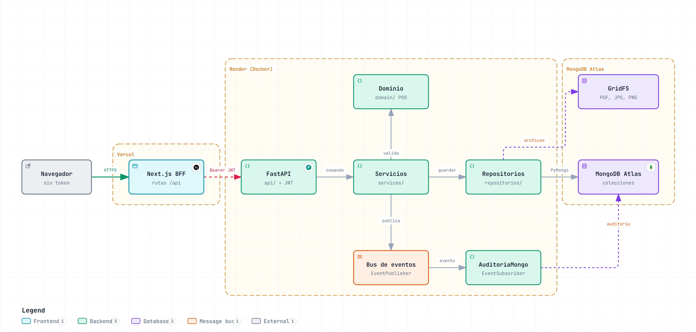
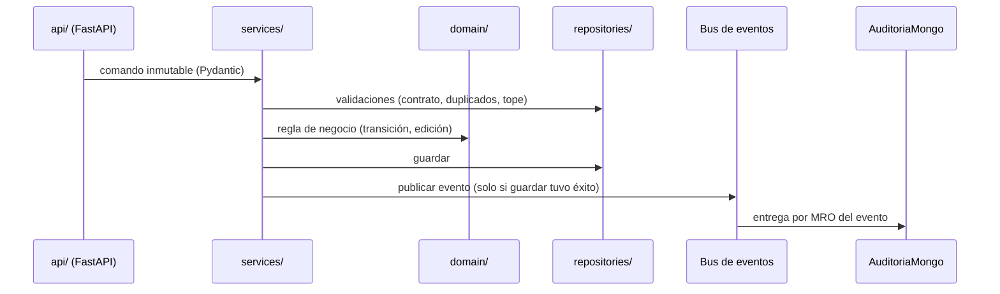

# Gestión Documental

[](https://github.com/Juanxo17/gestion-documental/actions/workflows/ci.yml)


Plataforma para radicar, revisar, aprobar y pagar las **cuentas de cobro** de los contratistas de una entidad pública, con sus soportes documentales, control de acceso por roles y trazabilidad completa de cada acción.

Es el proyecto integrador de un curso de programación orientada a objetos: el núcleo está construido para mostrar abstracción, jerarquías de herencia, composición, LSP, polimorfismo y una arquitectura basada en eventos sobre MongoDB. Todos los datos son sintéticos.

**En vivo:** https://gestion-documental-livid.vercel.app

## Probarlo

Contraseña de todos los usuarios de ejemplo: `Demo2025*`

| Usuario | Rol | Puede |
|---|---|---|
| `ana.rodriguez@entidad.gov.co` | Administrador | Todo, incluido pagar, gestionar usuarios y ver la auditoría |
| `jorge.martinez@entidad.gov.co` | Supervisor | Gestionar contratos y cambiar el estado de las cuentas |
| `maria.cifuentes@entidad.gov.co` | Revisor | Pasar cuentas a revisión, aprobarlas o rechazarlas |
| `luz.paredes@entidad.gov.co` | Radicador | Radicar, editar y adjuntar documentos. Debe cambiar la contraseña al entrar |
| `pedro.sarmiento@entidad.gov.co` | Consulta | Usuario inactivo en los datos de ejemplo: el sistema rechaza su acceso |

El backend corre en el plan gratuito de Render: si estuvo inactivo, la primera petición puede tardar hasta un minuto y la interfaz lo avisa.

## Arquitectura



El navegador solo habla con las rutas `/api` de Next.js (patrón *Backend for Frontend*). Esas rutas guardan el JWT en una cookie `httpOnly`, `secure` y `sameSite=lax`, y reenvían cada petición al backend: el token nunca llega al JavaScript del navegador.

En el backend, cada caso de uso sigue el mismo recorrido:



| Capa | Responsabilidad |
|---|---|
| `domain/` | Reglas puras: jerarquía de documentos, cuentas, contratos, contratistas, usuarios. No conoce FastAPI ni PyMongo |
| `events/` | Comandos y eventos inmutables, `EventPublisher`, `EventSubscriber`, auditoría y notificador |
| `repositories/` | Una interfaz por agregado con implementación MongoDB (colecciones y GridFS) y en memoria |
| `services/` | Orquestación de cada caso de uso |
| `api/` | Rutas, autenticación JWT, permisos por rol y errores uniformes `{"error", "detalle"}` |

## Funcionalidades

- Radicación con reglas de negocio: contrato `ACTIVO` y vigente, número de cuenta único por contrato y suma de cuentas que nunca supera el valor del contrato.
- Flujo de estados `RECIBIDA → EN_REVISION → APROBADA/RECHAZADA → PAGADA`, con anulación y un historial que se muestra como línea de tiempo.
- Adjuntos PDF, JPG o PNG de hasta 10 MB, validados por su contenido y no por la extensión, guardados en GridFS con su sha256. La descarga verifica el hash antes de enviar.
- Roles y permisos según la matriz del diseño: bloqueo tras 5 intentos fallidos, usuarios inactivos y cambio obligatorio de contraseña.
- Auditoría persistente de cada evento y un resumen con agregaciones `$group` de MongoDB.
- Interfaz responsive y accesible que muestra solo las acciones permitidas al rol.

## Stack

| Área | Tecnología |
|---|---|
| Backend | Python 3.14, FastAPI, Pydantic, PyMongo, PyJWT, pwdlib (bcrypt) |
| Base de datos | MongoDB Atlas y GridFS |
| Frontend | Next.js 16 (App Router), React 19, TypeScript estricto, Tailwind CSS 4 |
| Calidad | pytest, Playwright, ruff, mypy estricto, ESLint, pre-commit |
| Infraestructura | Docker, Docker Compose, GitHub Actions, Render, Vercel |

## Correr en local

Requisitos: [uv](https://docs.astral.sh/uv/), Node 20 o superior y una base en MongoDB Atlas.

```bash
cp .env.example .env                 # MONGO_URI, MONGO_DB, JWT_SECRET, CORS_ORIGINS
uv sync
uv run python scripts/seed.py        # carga los datos de ejemplo y los PDF en GridFS
uv run fastapi dev                   # API en http://127.0.0.1:8000/docs

cd frontend
cp .env.example .env.local           # BACKEND_URL=http://127.0.0.1:8000
npm install
npm run dev                          # http://localhost:3000
```

Con Docker (MongoDB sigue en Atlas):

```bash
docker compose up --build            # frontend en :3000, backend en :8000
```

Sin base de datos ni red, `uv run python demo.py` recorre en consola los temas del curso con repositorios en memoria.

## Pruebas

```bash
uv run pytest                        # más de 330 pruebas, sin red
uv run pytest -m integracion         # la misma batería contra Atlas y GridFS
uv run ruff check . && uv run mypy .
cd frontend && npm run lint && npm run typecheck && npm run build
npm run e2e                          # Playwright: login, radicar y aprobar
```

Los repositorios de memoria y de MongoDB pasan la misma batería de pruebas (principio de sustitución de Liskov aplicado a la persistencia). La matriz rol por endpoint verifica los permisos de los 5 roles en 22 rutas.

## Despliegue

- **Backend:** Render, con el `Dockerfile` (etapas separadas con uv, usuario no root y healthcheck a `/health`) descrito en `render.yaml`.
- **Frontend:** Vercel, con `frontend/` como raíz y la variable `BACKEND_URL`.
- **CI:** GitHub Actions ejecuta ruff, mypy y pytest para el backend, y lint, typecheck y build para el frontend, en cada push y pull request.

## Estructura

```
.
├── src/gestion_documental/
│   ├── domain/          reglas de negocio y jerarquías de clases
│   ├── events/          comandos, eventos, publicador y suscriptores
│   ├── repositories/    interfaces, MongoDB, GridFS y memoria
│   ├── services/        casos de uso
│   └── api/             rutas FastAPI, seguridad y errores
├── frontend/            Next.js (pantallas, BFF y pruebas e2e)
├── tests/               pruebas de dominio, servicios, API y repositorios
├── scripts/seed.py      datos de ejemplo
├── demo.py              demostración en consola
├── docs/                diagrama de arquitectura
├── Dockerfile, docker-compose.yml, render.yaml
└── .github/workflows/ci.yml
```
